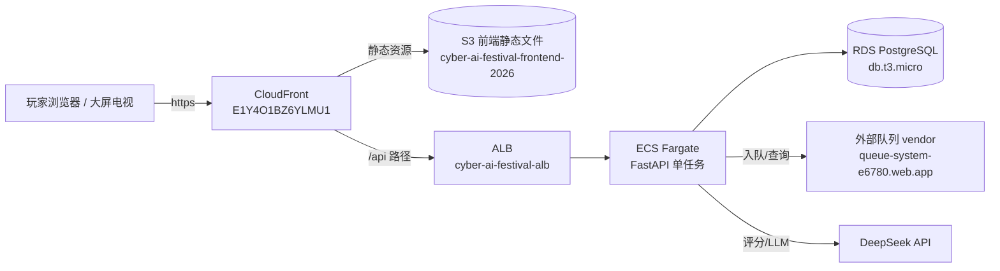

# Cyber AI Festival 系统全景手册（跨项目交接文档）

> ⚠️ **本文件是跨 session、跨项目的唯一共享 memory。**
>
> 分三部分：
> - **Part A**：现有系统 `cyber_ai_festival` 的全部知识（架构 / 技术选型 / AWS / 部署 / 踩坑）
> - **Part B**：新项目「香港 FTW」的架构设计（需求 / 决策 / 后端状态机 / 前端 / 数据库 / 部署 / 红线）
> - **Part C**：给新对话 Agent 的启动指引
>
> 新对话开工前，请**先完整读完本文件**，再动手。本文件是自包含的，不依赖任何会话记忆。

- 生成日期：2026-10-07，最近更新：2026-10-11
- 现有系统活动窗口：2026-09-26 ~ 2026-10-01（阿联酋时间 UTC+4），已结束；**但后续活动仍会继续使用，必须保持稳定**

---

## 目录

### Part A：现有系统（cyber_ai_festival）

1. [系统总览](#1-系统总览)
2. [前端架构与技术选型](#2-前端架构与技术选型)
3. [后端架构与技术选型](#3-后端架构与技术选型)
4. [AWS 基础设施清单与配置](#4-aws-基础设施清单与配置)
5. [部署流程](#5-部署流程)
6. [关键环境变量与凭据](#6-关键环境变量与凭据)
7. [踩坑记录（重要，务必先读）](#7-踩坑记录重要务必先读)
8. [AWS 复用与隔离策略](#8-aws-复用与隔离策略)
9. [相关文档索引](#9-相关文档索引)

### Part B：新项目架构设计（香港 FTW）

10. [需求与定位](#10-需求与定位)
11. [已定架构决策](#11-已定架构决策)
12. [Monorepo 结构](#12-monorepo-结构)
13. [后端设计：状态机 + 题型插件化](#13-后端设计状态机--题型插件化)
14. [前端设计：zustand + 题型渲染器](#14-前端设计zustand--题型渲染器)
15. [数据库设计](#15-数据库设计)
16. [AWS 部署（隔离优先）](#16-aws-部署隔离优先)
17. [操作红线（铁律）](#17-操作红线铁律)
18. [落地路径](#18-落地路径)

### Part C：新对话启动指引

19. [给新 Agent 的开工说明](#19-给新-agent-的开工说明)

---

# Part A：现有系统（cyber_ai_festival）

## 1. 系统总览

单前端 SPA + 单后端 FastAPI + PostgreSQL，外加两个外部依赖：**队列 vendor** 与 **DeepSeek LLM**。



核心特征：

- **同源部署**：前端 CloudFront 把 API 路径反向代理到后端 ALB，前端无需跨域。
- **WS 实时答题**：Ultimate Showdown（`/final`）用 WebSocket 做房间制实时答题。
- **单人沉浸游戏**：Hallucinate / DataShadows / RetailDemolition / Phishing 四个游戏各自独立计分。
- **分数归一**：所有游戏分数统一归一化到 0–100 后写库（`SCORE_MAX = 100`）。

---

## 2. 前端架构与技术选型

### 2.1 技术栈

| 类别 | 选型 | 版本 |
|---|---|---|
| 框架 | React | ^19.2 |
| 语言 | TypeScript | ~5.9 |
| 构建 | Vite | ^7.2 |
| UI 组件库 | MUI | ^7.3 |
| 样式 | Tailwind CSS + Emotion | ^4.1 / ^11.14 |
| 路由 | react-router-dom | ^7.13 |
| 富文本编辑器 | TipTap | ^3.19 |
| 二维码 | qrcode.react + html5-qrcode | ^4.2 / ^2.3 |
| 图标 | lucide-react | ^0.563 |
| HTML→MD | turndown | ^7.2 |

### 2.2 目录结构与职责

```
src/
├── main.tsx / App.tsx          # 入口：ThemeProvider + Router
├── routes/AppRoutes.tsx        # 全部路由表
├── components/
│   ├── common/                 # Header、GameExitButton、MatrixRainBackground、Countries 等
│   ├── functional/             # AdminPage、LeaderboardPage、QuestionBankDialog、ScoringSystem
│   ├── sharedPages/            # LoginPage、RegisterPage、MePage、RankingPage、DesignPage
│   └── ui/                     # ArcadeButton、ArcadeTypography、LightSign
├── pages/
│   ├── 0_HomePage/             # 首页
│   ├── 1_DeepFake/             # 未注册路由（占位）
│   ├── 2_Hallucinate/          # 游戏 2：幻觉识别（品红）
│   ├── 3_DataShadows/          # 游戏 3：数据阴影（青）
│   ├── 4_RetailDemolition/     # 游戏 4：零售拆除（黄）
│   ├── 5_Phishing/             # 游戏 5：钓鱼邮件（绿，含 8 分钟倒计时）
│   └── 6_UltimateShowdown/     # 游戏 6：终极对决（橙，WebSocket 实时答题）
├── hooks/                      # useGameWebSocket、useKioskMode、useClickSound、useScoreSubmitAndGo
├── services/                   # api.ts（apiFetch + API key 头）、scoreSubmission.ts
├── theme/theme.ts              # 主题色、字体、MUI 全局配置
└── utils/                      # userStorage、countryFlag、clickSound
```

### 2.3 关键文件说明

| 文件 | 职责 |
|---|---|
| `services/api.ts` | `API_URL = VITE_API_URL`，`apiFetch` 自动带 `X-API-Key` 头 |
| `services/scoreSubmission.ts` | 提交分数：`Math.max(serverScore, current)` **只增不减**，0–100 归一 |
| `hooks/useGameWebSocket.ts` | Ultimate 状态机：`idle→waiting→countdown→bonus→reading→question→result→leaderboard→finished` |
| `utils/userStorage.ts` | 身份：`sessionStorage.cyber_ai_user`（游戏机台）/ `localStorage.cyber_ai_user_persistent`（手机个人面板） |
| `theme/theme.ts` | 街机霓虹主题；`MuiTextField.defaultProps.autoComplete='off'`（注意：Chrome 常无视） |

### 2.4 路由表

| 路由 | 页面 |
|---|---|
| `/` | 首页 |
| `/login/:game` | 游戏登录（默认二维码登录） |
| `/me` | 手机个人面板（扫码登录入口 + 分数 + 排名 + 队列） |
| `/ranking` `/ranking/game/:game` | 排行榜 |
| `/leaderboard` `/tv` | 大屏 kiosk 排行榜（`/tv` 带看门狗自愈 + 周期硬重载） |
| `/admin` | 管理面板（用户/分数 CRUD、房间、题库、配平） |
| `/hallucinate` `/datashadows` `/retaildemolition` `/phishing` | 四个单人游戏 |
| `/final` | Ultimate Showdown（房间制实时答题） |

### 2.5 游戏分数字段

`Score` 表字段：`game1_score`（Hallucinate）、`game2_score`（DataShadows）、`game3_score`（RetailDemolition）、`game4_score`（Phishing）、`game5_score`（Ultimate）、`total_score`。

---

## 3. 后端架构与技术选型

### 3.1 技术栈

| 类别 | 选型 |
|---|---|
| 语言 | Python 3.12 |
| Web 框架 | FastAPI + Uvicorn |
| ORM | SQLAlchemy 2 |
| 迁移 | Alembic |
| 数据库驱动 | psycopg2-binary（**已强制，见踩坑 #7**） |
| LLM | openai SDK → DeepSeek API |
| HTTP 客户端 | httpx |

### 3.2 目录结构

```
app/
├── main.py          # FastAPI 入口：建表 + 种子数据 + 挂载 9 个 router
├── config.py        # pydantic-settings 环境变量
├── constants.py     # 游戏分类（7 类）等共享常量
├── database.py      # 引擎 + _postgres_driver_url()（强制 psycopg2）
├── models/          # users / scores / rooms / room_players / player_answers / questions
├── schemas/         # Pydantic 请求/响应模型
├── crud/            # ORM 操作
├── routers/         # 9 个路由模块（见下）
├── websocket/game.py# Ultimate 房间制状态机（内存态）
├── services/        # 外部服务封装（队列等）
├── prompts.py       # Phishing 评分 rubric（与前端 scoringRubric.ts 对应）
└── migrations/      # Alembic
```

### 3.3 路由清单（9 个）

| 前缀 | 模块 | 用途 |
|---|---|---|
| `/users` | users.py | 注册/登录/admin-login/CRUD/userscores/purge |
| `/scores` | scores.py | 分数 GET/PUT（max）|
| `/rankings` | rankings.py | 排行榜（game1~5 + total，排除 admin）|
| `/rooms` | rooms.py | 房间创建/加入/暂停/恢复/结束/删除/purge |
| `/questions` | questions.py | 题库 CRUD |
| `/llm` | llm.py | `POST /llm/chat`（DeepSeek 评分）|
| `/queue` | queue.py | 外部队列代理 |
| `/events` | events.py | 活动事件 CRUD |
| `/qr-login` | qr_login.py | 二维码登录配对/状态 |

所有 router 都带 `Depends(verify_api_key)`（`X-API-Key` 校验），`/health` 除外。

### 3.4 数据模型

- `users`：玩家 + admin（`role` 列区分）
- `scores`：`user_id` 主键，`game1~5_score` + `total_score`
- `rooms` / `room_players` / `player_answers`：Ultimate 房间制数据
- `questions`：题库（7 分类：`ai / hallucination / data / agent / phishing / bonus / uae`；bonus ×2、uae ×3 强制排最后）

### 3.5 WebSocket 状态机（重要）

`websocket/game.py` 的 `GameSession` 是**进程内内存字典** `sessions[room_code]`，**单进程**运行：

- 阶段：`waiting → countdown → bonus(老虎机预告) → reading(5s 读题) → question → result → leaderboard → finished`
- **内存态意味着：多 worker 会分裂；替换 ECS task 会清空所有房间** —— 这是「活动期间禁止重启容器」的根源。

---

## 4. AWS 基础设施清单与配置

> 区域：`ap-south-1`（孟买）。账号 ID：`866730904414`。

| 资源 | 标识 | 说明 |
|---|---|---|
| S3 bucket | `cyber-ai-festival-frontend-2026` | 前端静态文件 |
| CloudFront | `E1Y4O1BZ6YLMU1` | 分发，域名 `d24umo4oysfx97.cloudfront.net`（无自定义别名）|
| ALB | `cyber-ai-festival-alb` | `cyber-ai-festival-alb-2006617150.ap-south-1.elb.amazonaws.com` |
| Target Group | `cyber-ai-festival-tg`（`1b3727dc0db8460f`）| 指向 ECS 服务 |
| ECS Cluster | `cyber-ai-festival-cluster` | 1 个 service |
| ECS Service | `cyber-ai-festival-service` | 单任务 `cyber-ai-festival-task`，0.5 vCPU / 1GB |
| ECR repo | `cyber-ai-festival-backend` | 后端镜像 |
| RDS | `cyber-ai-festival-db-recovered` | PostgreSQL，`db.t3.micro`，20GB |
| 日志组 | `/ecs/cyber-ai-festival-backend` | CloudWatch Logs |

### 4.1 CloudFront 配置（关键）

**缓存行为（API 白名单）**：以下路径指向 ALB origin，`MinTTL/DefaultTTL/MaxTTL = 0/0/0`，允许全部 HTTP 方法：

```
/events/*  /health  /llm/*  /qr-login/*  /questions/*  /queue/  /queue/*
/rankings/*  /rooms/*  /scores/*  /users/  /users/*  /ws/*
```

默认行为指向 **S3 origin**（`HEAD/GET/OPTIONS`），`TTL = 0/86400/31536000`。

**错误响应（分发级）**：

```
403 → 200 + /index.html（ErrorCachingMinTTL=30）
404 → 200 + /index.html（ErrorCachingMinTTL=30）
```

⚠️ 这是「200 伪装」的来源，见踩坑 #2。

### 4.2 网络与安全组

- ALB 安全组：入站仅 `80/tcp ← CloudFront 前缀 pl-9aa247f3`，直连 ALB 已拒（HTTP 000）。
- ECS 子网必须是 ALB 启用的 AZ（1a/1b），否则报 `Target is in an Availability Zone that is not enabled`。

### 4.3 RDS 配置

- 删除保护 ✅、备份保留 7 天 ✅、维护窗口 wed 03:00 ✅、AutoMinor 升级关闭 ✅
- 活动前快照：`cyber-ai-festival-db-pre-event-20260925`
- PITR 可用（`LatestRestorableTime` 实时跟进，约 5 分钟粒度）

---

## 5. 部署流程

### 5.1 前端（自动，推荐）

```bash
git push main   # GitHub Actions 自动 build → S3 → CloudFront，约 4-6 分钟
```

验证部署：轮询 `https://d24umo4oysfx97.cloudfront.net/` 里 `assets/index-*.js` 的哈希变化；再 grep 线上 bundle 里的预期字符串（**注意 minify 会剥离注释，字符串字面量还在**）。

### 5.2 后端（⚠️ CI 是坏的，手动部署）

GitHub Actions 后端流水线在「Build, tag, and push image to Amazon ECR」步骤失败。**当前必须手动部署，且必须用 amd64 平台**（Mac 是 arm64，直接 build 会得到 arm64 镜像，Fargate 起不来）：

```bash
cd ~/Documents/Work/MENAT_AI/cyber_ai_festival_be
R=866730904414.dkr.ecr.ap-south-1.amazonaws.com
REPO=cyber-ai-festival-backend
TAG=$(git rev-parse HEAD)

docker build --platform linux/amd64 -q -t $R/$REPO:$TAG .
docker push $R/$REPO:$TAG
docker tag $R/$REPO:$TAG "$R/${REPO}:latest" && docker push "$R/${REPO}:latest"
```

然后：

1. `aws ecs describe-task-definition`（取最高 revision）
2. 替换镜像为 `${REPO}:latest`，剥离字段：`taskDefinitionArn, revision, status, requiresAttributes, compatibilities, registeredAt, registeredBy`
3. `aws ecs register-task-definition` → `aws ecs update-service`
4. 轮询 `deployments[?status==PRIMARY].rolloutState == COMPLETED` 且旧 task running=0

⚠️ **活动期间禁止 push 后端 / 重启容器**（内存态房间清零）。活动已结束，此铁律解除。

### 5.3 排查命令

```bash
# CloudFront 是否把 API 错误伪装成 200
curl -s -o /dev/null -w '%{http_code} %{content_type}\n' \
  https://d24umo4oysfx97.cloudfront.net/scores/1 -H "X-API-Key: $KEY"

# WS 握手必须用 --http1.1（HTTP/2 会得到 200 假象）
curl --http1.1 -i -N -H "Connection: Upgrade" -H "Upgrade: websocket" ...

# ECS 部署卡住时看容器日志（崩溃常发生在 import 期，没有 ERROR）
aws logs tail /ecs/cyber-ai-festival-backend --follow
```

---

## 6. 关键环境变量与凭据

> ⚠️ **敏感值不落文档**。下面用 `<...>` 占位，实际值存于各环境的 `.env` 文件 / 密钥管理器。

### 6.1 前端（`.env.production`）

```
VITE_API_URL=https://d24umo4oysfx97.cloudfront.net
VITE_API_KEY=<见 .env.production>
VITE_WS_URL=wss://d24umo4oysfx97.cloudfront.net
```

### 6.2 后端（环境变量，`app/config.py` 读取）

| 变量 | 说明 |
|---|---|
| `database_url` | PostgreSQL 连接串 |
| `deepseek_api_key` / `deepseek_base_url` | LLM 凭据（默认 `https://api.deepseek.com`）|
| `api_key` | `X-API-Key` 校验值 |
| `queue_enabled` / `queue_base_url` / `queue_queue_id` / `queue_api_key` | 外部队列 vendor（见 `doc/QUEUE_INTEGRATION.md`）|
| `cors_origins` | 逗号分隔 CORS 白名单，空 = 宽松 `*` |

### 6.3 外部队列 vendor

- base：`https://queue-system-e6780.web.app/api`（v1）
- **队列 id 会被主办方删掉重建** → 后端每次入队前 `GET /v1/queues` 取 `createdAt` 最大者（`resolve_queue_id()`）
- 大屏 = Firebase RTDB **只读免鉴权**：`https://queue-system-e6780-default-rtdb.firebaseio.com/queues/<queueId>/members.json`

---

## 7. 踩坑记录（重要，务必先读）

### #1 端口铁律：1688 不可碰
用户本地 dev 服务跑在 **1688**（`npm run dev` / `dev:prod`）。**绝不 kill/占用/改动**。需要浏览器验证时另起独立端口：
```bash
npx vite --mode development --port 1690 --strictPort
```
验证完只清理自己起的进程；动任何端口前先 `lsof -nP -iTCP:<port>` 确认归属。

### #2 CloudFront「200 伪装」—— 静默失效的头号根源
分发把 **403/404 全局重写为 `200 + /index.html`**（分发级，对 API 同样生效）。后果：任何后端错误都变成 `200 text/html`，前端 `res.json()` 直接炸。

两种故障模式同症状：
- **模式 A 未转发**：路径不在 API 行为白名单 → 落 S3 → S3 403/404 → 伪装
- **模式 B 已转发但源站 404**：如 `GET /llm/`（后端只有 `POST /llm/chat`）

排查：`curl -w '%{content_type}'` 看 `application/json` vs `text/html`；`x-cache: Error from cloudfront` + `age` 即命中兜底缓存；直连 ALB 看源站真实状态码。

### #3 裸路径 `/users`、`/rooms` 不匹配任何行为
行为白名单是 `/users/` 和 `/users/*`，**裸路径 `/users`（无尾斜杠）两者都不匹配** → 落 S3 → 伪装成 200 HTML。实证：`POST /users` → `200 text/html`；`POST /users/` → `422 application/json`。

**判定口径：调 API 一律带尾斜杠。** 根治：CloudFront 加精确 `PathPattern`（`/users`、`/rooms`）。

### #4 WebKit/Safari 的 `JSON.parse` 报错文案
`The string did not match the expected pattern.` 不是表单校验错误，而是 **Safari 解析 HTML 失败**的文案（Chrome 会说 `Unexpected token '<'`）。

**教训：`res.ok === true` 不足以判定成功，必须校验 `content-type` 含 `application/json`。**

### #5 依赖未锁定会定时引爆
`requirements.txt` 全是 `>=` 无上界。曾因拉到新版 SQLAlchemy，把 `postgresql://` 默认驱动从 psycopg2 改成 psycopg3 → `ModuleNotFoundError: No module named 'psycopg'` → 容器 exit 1。

已修复：`app/database.py` 的 `_postgres_driver_url()` 强制改写为 `postgresql+psycopg2://`。**根治待办：pin requirements（至少 sqlalchemy/psycopg2）。**

### #6 sessionStorage 状态的生命周期（线上事故）
Phishing 倒计时的 `deadline` 写进 `sessionStorage` 实现「刷新不重置」，但**提交/退出时没清除** → 玩完一局后回到 `/phishing` 继承上一局剩余时间；若已过期，**一进页面就立刻自动提交**。

修复：在**所有出口**（提交后 + 降级 0 分后 + `GameExitButton` 退出）都 `removeItem`。
**教训：凡是用 storage 做「跨刷新保持」的状态，先列出它的所有「生命周期结束点」并逐个清理。**

### #7 测试盲区（务必记住）
验证倒计时时每次都先 `sessionStorage.clear()` 再进页面，永远在测「全新一局」，恰好绕过了跨局残留。

**凡带持久化状态的交互，必须专门测「重复进入 / 第二次使用」路径，而不是只测首次进入。**

### #8 Ultimate WebSocket 是内存态
`sessions` 是进程内字典，单进程。**多 worker 会分裂，替换 task 会清空房间**。这就是活动期间禁止重启后端的原因，也是新活动必须独立 service 的原因。

### #9 后端镜像必须 amd64
Mac（arm64）直接 `docker build` 会得到 arm64 镜像，Fargate 起不来。必须 `--platform linux/amd64`。

### #10 zsh 只读变量
`UID` / `PID` / `status` 是 zsh 只读变量，赋值报 `failed to change user ID: operation not permitted`。用别的名字。

### #11 Chrome 无视 `autocomplete="off"`
MUI 全局 `autoComplete='off'` 对 Chrome 的 email/address 字段无效（Chrome 有意忽略）。要禁用需 `autocomplete="new-password"` / 随机 `name` / `readOnly` 技巧。受影响：Phishing 的 From/To/Subject、DataShadows 注册调查、Retail 结账表单。

---

## 8. AWS 复用与隔离策略

> ⚠️ **重要变更（2026-10-11）**：因为现有系统后续活动仍要继续使用、必须保持稳定，新项目的隔离策略从「复用优先」升级为「**隔离优先**」。除 VPC/子网外，其余资源**全部新建**，避免任何共享点被误改后连累现有系统。

| 资源 | 做法 | 理由 |
|---|---|---|
| VPC / 子网 | ✅ **复用（唯一共享项）** | 物理网络，改动需专门操作，风险极低 |
| 安全组 | 🆕 **新建** | 避免误删现有 CloudFront 白名单 |
| ALB | 🆕 **新建** | 避免加 listener rule 时误伤现有规则 |
| ECS Cluster | 🆕 **新建**（成本≈0）| 彻底隔离部署目标，避免部署脚本写错 cluster 名 |
| ECR | 🆕 新建 `hk-ftw-backend` | 完全隔离 |
| ECS task + service | 🆕 复制改 tag | **独立 service，绝不共用**（内存态，见踩坑 #8）|
| RDS | 🆕 **新建实例** `hk-ftw-db` | 现有 db.t3.micro 已紧张，且需完全隔离 |
| S3 | 🆕 新建 `hk-ftw-frontend` | 完全隔离 |
| CloudFront | 🆕 新建分发 | 复制 behavior + 错误重写配置（见踩坑 #2/#3）|
| 域名 + 证书 | 可选：新 ACM 证书 + Route53 CNAME | placeholder 阶段先用 cloudfront.net |
| CI/CD | 🆕 复制 GitHub Actions，改 S3 bucket / ECR tag / 分发 ID | 前后端 CI 独立 |
| 队列 vendor | 按需新建 queue | placeholder 阶段不需要 |
| LLM | 复用或新 DeepSeek key | |

**根本解法**：先把现有环境 IaC 化（Terraform 或 AWS CDK），之后复制环境 = 改几个变量跑一条命令，约 1 小时，永久摆脱手工配置。

---

## 9. 相关文档索引

| 文档 | 内容 |
|---|---|
| `doc/README.md` | 文档框架、状态/优先级定义、更新规范 |
| `doc/ISSUES.md` | 唯一工作追踪清单（SEC-/ARCH-/BE-/G1~G5- 前缀）|
| `doc/QUEUE_INTEGRATION.md` | 外部排队系统接入 |
| `doc/TV_DISPLAY_SETUP.md` | 三星 Hospitality 电视大屏配置 |

---

# Part B：新项目架构设计（香港 FTW）

## 10. 需求与定位

**定位**：为「香港 FTW」活动做一款新游戏，与现有 `cyber_ai_festival` **完全平行、完全隔离**。

**新游戏玩法**（一句话）：把四个游戏串成一条主线，中间穿插 quiz，所有人**同时进行**，题型不只是选择题，还有 trust/doubt（信任/怀疑）和各种互动题，管理员做简单控制（暂停 / 结束 / 状态回退到某个游戏）。

拆解为技术需求：

1. **一条主线流程**：`game1 → quiz → game2 → quiz → …`，所有玩家同步推进
2. **多题型**：choice（选择题）、trust_doubt（信任/怀疑）、interactive（互动题），未来可扩展
3. **管理员控制**：暂停、结束、**回退到任意节点**
4. **纯 Web 开发**，单人用 Agent 开发前后端
5. **保留现有游戏**：现有 4 个游戏逻辑复用（作为主线里的"game 节点"），数据库隔离

## 11. 已定架构决策

> 以下决策已与用户确认，**新 Agent 不要推翻重来**，除非用户明确要求。

| 决策点 | 结论 | 理由 |
|---|---|---|
| 技术栈 | **React（Vite）+ FastAPI**，维持现状 | 多语言对 Agent 不是问题，且现有经验可复用 |
| 仓库结构 | **Monorepo**（单 repo，双目录）| 协议共享免费、原子提交、Agent 单 workspace |
| 协议同步 | 起步用**轻量共享**（TS 类型 + 后端 Pydantic 手写对应），稳定后升级 JSON Schema | 避免过度工程，题型稳定后再上代码生成 |
| 后端状态机 | **事件驱动显式状态机**，不用 if/else 巨类 | 支持流程回退、可测试 |
| 题型 | **注册表模式（插件化）** | 新增题型=加一个 handler + 一个前端组件，主流程零改动 |
| 流程 | **配置化**（DSL/列表描述主线）| 改流程不改代码 |
| 前端状态 | **zustand**（中央 store）| 极简、无样板、Agent 友好 |
| 数据库 | **完全隔离**（新 RDS 实例），计分用长表/JSONB | 不污染现有 schema，流程变了不改表 |
| 隔离策略 | **隔离优先**（除 VPC 外全新建，见第 8 章）| 现有系统下周还要稳定使用 |
| 代码复用 | 只复用 UI 组件库 + 主题 + 部署管道，**不迁移旧游戏代码** | 旧游戏冻结，新游戏独立 |

## 12. Monorepo 结构

```
hk-ftw/
├── apps/
│   ├── web/                    # 前端 React + Vite + TS
│   │   ├── src/
│   │   ├── package.json
│   │   └── vite.config.ts
│   └── server/                 # 后端 FastAPI + Python 3.12
│       ├── app/
│       │   ├── main.py         # FastAPI 入口
│       │   ├── ws.py           # WebSocket 端点
│       │   ├── engine.py       # 游戏引擎（状态机）
│       │   ├── flow.py         # 流程配置（主线 DSL）
│       │   ├── question_types/ # 题型注册表（每个题型一个模块）
│       │   │   ├── base.py     # 题型基类/协议
│       │   │   ├── choice.py
│       │   │   ├── trust_doubt.py
│       │   │   └── interactive.py
│       │   └── ...
│       ├── requirements.txt
│       └── Dockerfile
├── packages/
│   └── shared/                 # ★ 前后端共享协议（只放协议，不放逻辑）
│       ├── package.json
│       └── src/
│           ├── messages.ts     # WS 消息协议
│           ├── questions.ts    # 题型定义
│           └── flow.ts         # 流程节点定义
├── package.json                # 根：pnpm workspace
├── pnpm-workspace.yaml
├── Makefile                    # make dev / make build / make deploy
└── README.md
```

**工具链**：pnpm workspace 管前端 + shared；后端用 pip + venv；Makefile 收敛统一命令。**不要上 Nx/Turborepo 等重型工具**。

**shared 边界铁律**：`packages/shared` **只放协议/类型/常量，绝不放业务逻辑**。

## 13. 后端设计：状态机 + 题型插件化

### 13.1 核心思想

把「流程」和「题型」解耦：流程只关心"现在到哪个节点、如何推进"，题型是**可插拔的处理器**。

### 13.2 题型协议（统一接口）

```python
# question_types/base.py
from typing import Protocol

class QuestionType(Protocol):
    type_key: str                    # 注册键，如 "choice" / "trust_doubt" / "interactive"

    def render(self, question) -> dict:         # 发给前端的展示数据
        ...

    def accept(self, session, answer) -> bool:  # 是否收下这个答案
        ...

    def score(self, answers) -> dict:           # 计分结果
        ...

    def timeout_behavior(self) -> str:          # 超时行为（如 "auto_submit" / "discard"）
        ...
```

注册表：

```python
QUESTION_TYPES: dict[str, QuestionType] = {
    "choice": ChoiceType(),
    "trust_doubt": TrustDoubtType(),
    "interactive": InteractiveType(),
}
```

新增题型 = 写一个模块 + 注册一行，主线流程零改动。

### 13.3 流程配置化

```python
# flow.py —— 主线用列表描述，改流程不改代码
ROUND_FLOW = [
    {"type": "game", "game": "hallucinate", "duration_sec": 180},
    {"type": "quiz", "question_ids": [12, 33, 41]},
    {"type": "game", "game": "datashadows", "duration_sec": 240},
    {"type": "quiz", "question_ids": [7, 8]},
    # ...
]
```

### 13.4 状态机与管理员控制

状态机节点：`idle → playing → paused → finished`，外加 `current_index` 指向当前流程节点。

管理员控制全部是**状态转换事件**，不要用 if/else 补丁：

| 管理员操作 | 状态机动作 |
|---|---|
| 暂停 | `playing → paused` |
| 恢复 | `paused → playing` |
| 结束 | `any → finished` |
| 回退到第 N 个游戏 | `current_index = N` + 广播新节点 |

### 13.5 关键技术点

- **WebSocket 内存态单进程**：`sessions` 字典，与现有 `game.py` 同理。**独立 service，禁止多 worker、禁止共用**。
- **DB 访问**：优先 SQLAlchemy 2 async + asyncpg，避免同步调用阻塞事件循环（现有系统踩过的坑）。
- **消息协议统一**：所有 WS 消息 `{type, payload}`，类型定义放 `packages/shared`。
- **计分纯函数化**：题型 handler 的 `score()` 写成纯函数，便于单测。

## 14. 前端设计：zustand + 题型渲染器

### 14.1 中央 store（zustand）

```tsx
const useGame = create((set) => ({
  phase: 'idle',
  current: null,        // 当前节点（game 或 quiz）
  answers: {},
  onMessage: (msg) => set(...),   // WS 消息统一入口
}));
```

### 14.2 题型渲染器（注册表模式）

```tsx
const renderers = {
  choice: ChoiceQuestion,
  trust_doubt: TrustDoubtQuestion,
  interactive: InteractiveQuestion,
};

// 主流程只做一件事：按 current.type 分发
<QuestionRenderer type={current.type} data={current.data} />
```

新增题型 = 加一个组件 + 注册一行，主流程不动。

### 14.3 关键原则

- **状态、业务、UI 三层分离**（吸取现有系统"巨型组件"教训）
- 复用现有 UI 组件库（`ArcadeButton` / `ArcadeTypography` / `MatrixRainBackground`）和主题系统
- WS 客户端从 `packages/shared` 导入消息类型，前后端类型永不 drift

## 15. 数据库设计

- **完全隔离**：新 RDS 实例 `hk-ftw-db`，不碰现有 `cyber-ai-festival-db-recovered`
- **计分模型**：不要硬编码 `game1~5_score`。用长表 `scores(user_id, stage_key, score)` 或 JSONB 列，流程变了不改表
- placeholder 阶段可先用 **SQLite / 内存** 跑通状态机，真实逻辑定了再建 RDS

## 16. AWS 部署（隔离优先）

> 详见第 8 章的隔离清单。核心：**除 VPC/子网外全部新建**，资源名统一 `hk-ftw-` 前缀。

placeholder 阶段的最小集（4 个必做）：

1. ECR repo `hk-ftw-backend`
2. ECS task def + service（新 cluster，独立）
3. S3 bucket `hk-ftw-frontend`
4. CloudFront 新分发（**必须复制现有分发的 behavior + 错误重写配置**，否则踩坑 #2/#3）

可暂缓：RDS（先用 SQLite）、域名证书（先用 cloudfront.net）、队列 vendor、LLM。

**部署命令要点**：
- 后端镜像必须 `--platform linux/amd64`（踩坑 #9）
- 前端 push main 自动部署；后端 CI 是坏的，手动部署（见第 5 章）

## 17. 操作红线（铁律）

> ⚠️ 这些规则必须写进新 repo 的 `.github/copilot-instructions.md`，Agent 必须遵守。

1. **现有 repo 默认只读** —— 除非用户明确说"改现有系统"，Agent 一律不动 `cyber_ai_festival` 和 `cyber_ai_festival_be` 的代码
2. **部署命令写死资源名** —— 用 `hk-ftw-` 前缀的变量，绝不手打 cluster/service 名
3. **共享资源改动必须问** —— VPC/子网（唯一共享项）的任何改动先问用户
4. **绝不调用现有系统的破坏性接口** —— 验证新系统时，URL 用新域名，不碰旧系统的 purge/删除接口
5. **现有系统活动期间冻结旧 ECS** —— 沿用铁律，禁止 push 后端/重启容器
6. **端口 1688 铁律** —— 用户 dev 服务跑在 1688，绝不 kill/占用；验证另起 1690/169x（见踩坑 #1）

## 18. 落地路径

```
阶段 0：新 repo 起骨架（monorepo + 状态机 + 1 个题型端到端跑通）
阶段 1：主线流程配置化（四个 game 节点留白 + quiz 节点）
阶段 2：多题型插件（choice / trust_doubt / interactive）
阶段 3：管理员控制（pause / end / back-to-stage）
阶段 4：数据库隔离 + AWS 部署（隔离优先）
```

---

# Part C：新对话启动指引

## 19. 给新 Agent 的开工说明

> 当新对话在 `hk-ftw` repo 中启动时，Agent 应先做以下事情。

### 开工前必读

1. **完整读完本文件**（尤其 Part A 第 7 章踩坑、Part B 全部、Part C 本章）
2. 确认当前阶段：如果 `hk-ftw` repo 还是空的，从**阶段 0（起骨架）**开始；如果已有代码，先读 `hk-ftw/README.md` 和现有目录结构

### 阶段 0 的具体任务（起骨架）

目标：一个能端到端跑通的最小可运行版本。

1. **Monorepo 骨架**：按第 12 章结构建 `apps/web` + `apps/server` + `packages/shared`
2. **后端**：FastAPI + WebSocket 端点 + `engine.py` 状态机 + `flow.py` 流程配置 + `question_types/choice.py` 一个题型
3. **前端**：Vite + React + zustand store + `QuestionRenderer` + `choice` 渲染组件
4. **协议**：`packages/shared/messages.ts` 定义 `{type, payload}` 消息，前端 import
5. **本地验证**：起后端（另起端口，**不碰 1688**），前端连上，玩家连接 → 状态机推进 → 显示占位页

### 全程必须遵守

- 第 17 章的全部操作红线
- 第 7 章的全部踩坑（尤其 #2 CloudFront 200 伪装、#8 内存态、#9 amd64）
- 遇到模棱两可，先问用户，不擅自决策

### 完成后

- 更新 `hk-ftw/README.md`
- 如发现本文档缺失/过时，**回补到本文件**（它是唯一共享 memory，要保持最新）

---

*文档完。本文件是跨 session、跨项目的唯一共享 memory，修改系统后请同步更新。*
